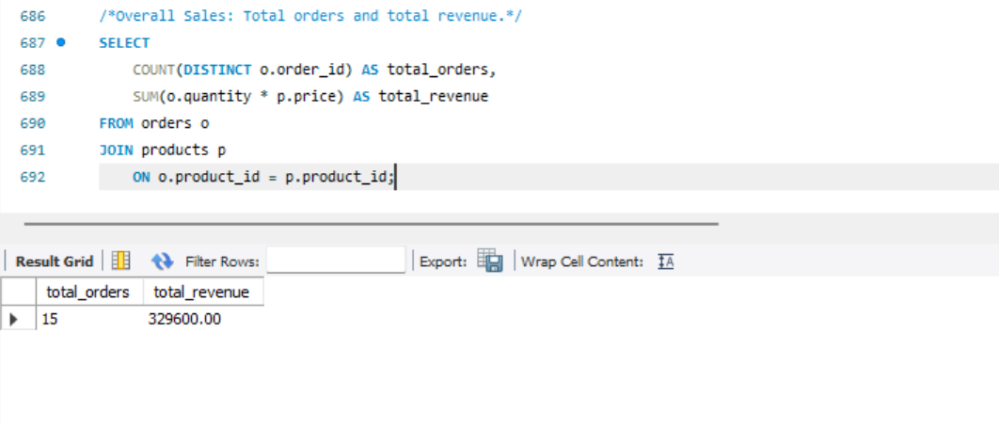
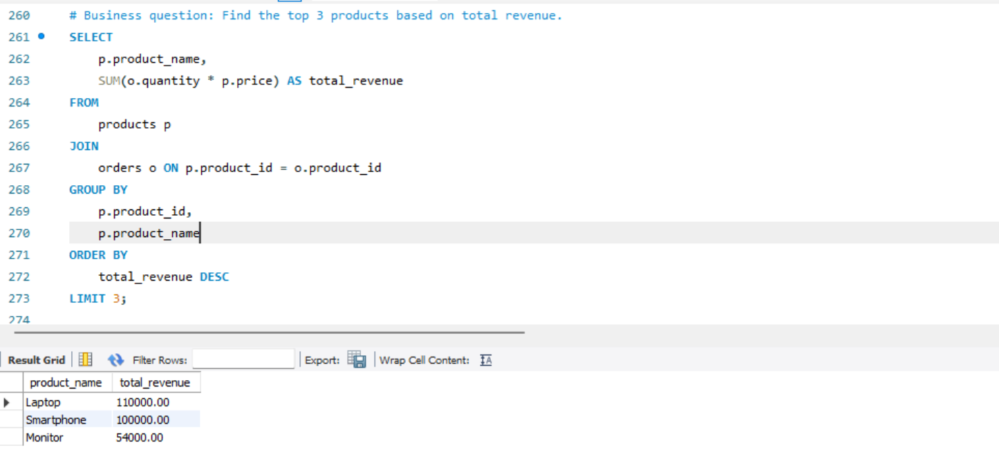
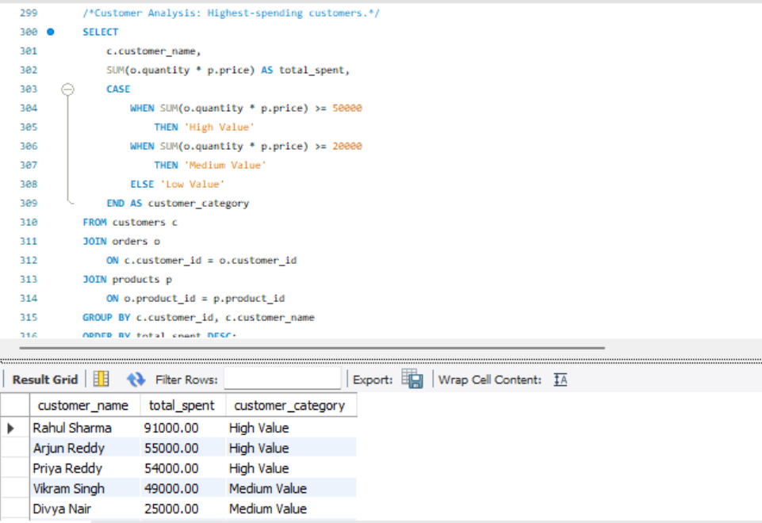
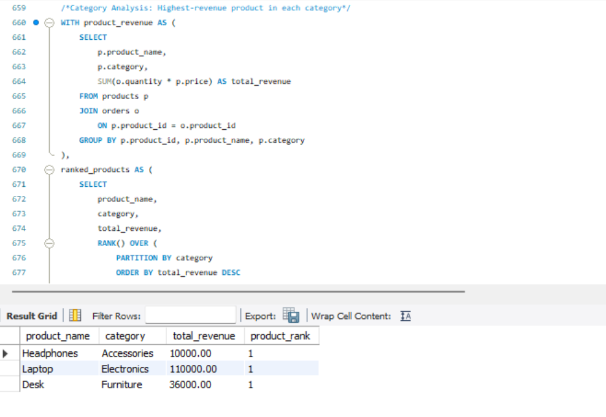
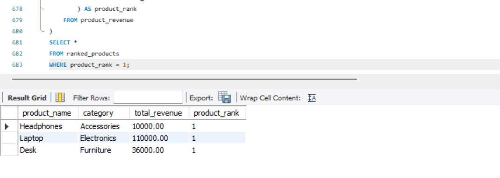

# Retail Sales Analysis Using SQL

## Project Overview
This project analyzes retail sales data using MySQL to identify sales trends, product performance, customer purchasing behavior, and revenue patterns.

The goal is to extract meaningful business insights that can support better business decisions.

## Dataset Scope

This project uses a small sample dataset created
for SQL learning and analysis.

- Customers: 11
- Products: 8
- Orders: 15
- Order date range: January 5–19, 2026

The findings represent this sample dataset and
should not be interpreted as actual market trends.

## Tools Used
- MySQL
- MySQL Workbench
- SQL

## How to Run This Project

1. Install MySQL and MySQL Workbench.
2. Download Retail_Sales_Analysis_Final.sql.
3. Open the file in MySQL Workbench.
4. Execute the complete script on a fresh database environment.
5. Explore the business analysis and advanced SQL queries.

Note: Run the setup script once on a fresh database.

## Database Structure
The project contains three tables:

1. **Customers:** Customer details such as name, city, state, and age.
2. **Products:** Product details such as product name, category, and price.
3. **Orders:** Order details including customer ID, product ID, quantity, and order date.

## SQL Concepts Used
- SELECT, WHERE, ORDER BY
- GROUP BY and HAVING
- Aggregate functions: SUM, AVG, COUNT
- INNER JOIN and LEFT JOIN
- Subqueries
- CASE WHEN
- Common Table Expressions (CTEs)
- Window functions: ROW_NUMBER(), RANK(), DENSE_RANK(), LAG(), LEAD()
- Running totals and PARTITION BY

## Business Questions Explored
- What is the total revenue generated?
- Which products generate the highest revenue?
- Which product category performs best?
- Which city generates the highest revenue?
- Who are the highest-spending customers?
- What is the average order value?
- Which customers have not placed any orders?
- Which products generate the highest revenue within each category?

## Key Findings
- Total revenue generated: ₹3,29,600
- Total orders: 15
- Highest revenue-generating product: Laptop (₹1,10,000)
- Lowest revenue-generating product: Mouse
- Highest revenue-generating category: Electronics
- Highest revenue-generating city: Hyderabad
- Highest-spending customer: Rahul Sharma (₹91,000)
- Average order value: ₹21,973.33

### Additional Business Metrics

| Business Metric | Result |
|---|---:|
| Electronics Revenue | ₹2,64,000 |
| Hyderabad Revenue | ₹1,11,000 |
| Mouse Revenue | ₹5,600 |

## Project Screenshots

### 1. Overall Sales Analysis

### 2. Top 3 Products by Revenue

### 3. Top Spending Customers

### 4. Highest-Revenue Product in Each Category

**Part 1**

**Part 2**

## Project Outcome
This project provided practical experience in SQL querying, data analysis, joining multiple tables, aggregating sales data, and using window functions to derive business insights.
